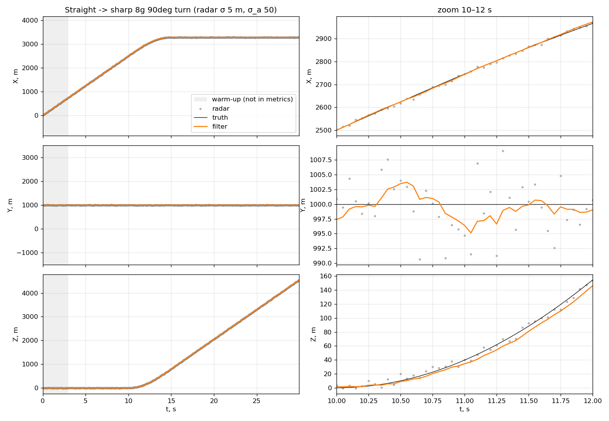
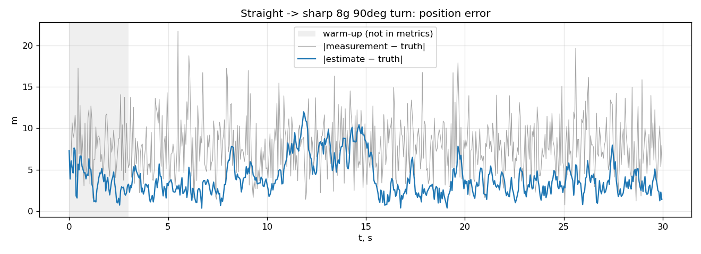
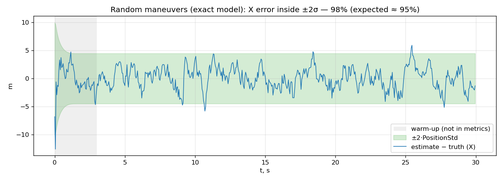

# Kalman Filter for Unity

## Implementation

- `Scripts/Kalman1D.cs`: a 1D filter with a constant-velocity model. State `[x, v]`, measurement `z = x + noise`. It takes two noise parameters: the radar noise and the random acceleration of the target.
- `Scripts/KalmanFilter3D.cs`: a 3D tracker made of three independent 1D filters. `Update(z, dt)` handles irregular `dt`, and when a measurement is missing or invalid (NaN/Inf) it only predicts. `PredictPosition(t)` gives the target position `t` seconds ahead.

## Testing

Parameters: radar noise σ = 5 m, acceleration noise σ_a = 50 m/s², 50 Monte Carlo runs per scenario.

Target trajectories in 3D:
- random maneuvers: random acceleration at every step
- straight flight with radar dropouts and irregular update intervals
- straight flight, then a sharp 90° turn at 8g
- steady circular turn at 3g
- snake path with altitude changes

## Validation plots

### 3D tracking: X, Y, Z over time



Radar (dots), truth (black) and filter (orange) on all three axes. The zoomed view on the right shows that the filter line is much smoother than the radar points. During the turn the filter is slightly behind the true path: it assumes straight motion and needs a few measurements to notice the turn.

### Position error: filter vs radar



The filter combines many measurements with the motion model, so its error (blue) stays mostly below the radar's error (gray). It grows during the turn (t ≈ 10–15 s) and returns to normal about 0.6 s after the turn ends.

### Consistency: error inside ±2σ



The green band is ±2σ, and the actual error stays inside it about 95% of the time (over 50 runs). So the filter’s own uncertainty estimate matches its actual error: the filter is consistent.

## How to run

Requires the .NET 10 SDK and Python 3 with `numpy`, `pandas`, `matplotlib`. The tests run outside Unity; the `~` in the folder name makes Unity ignore `KalmanTest~`.

```bash
cd "KalmanTest~"
dotnet run                 # runs all checks and writes CSV to output/
python3 plot_results.py    # draws the plots from output/ into plots/
```
